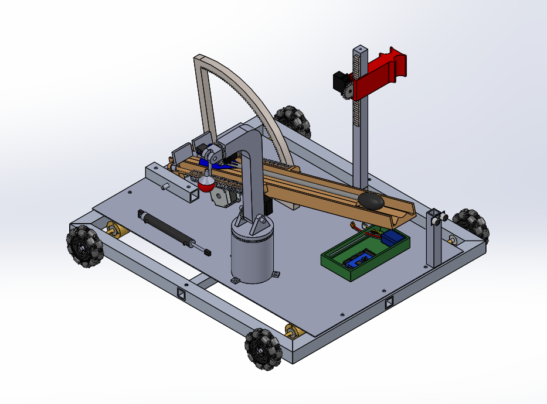
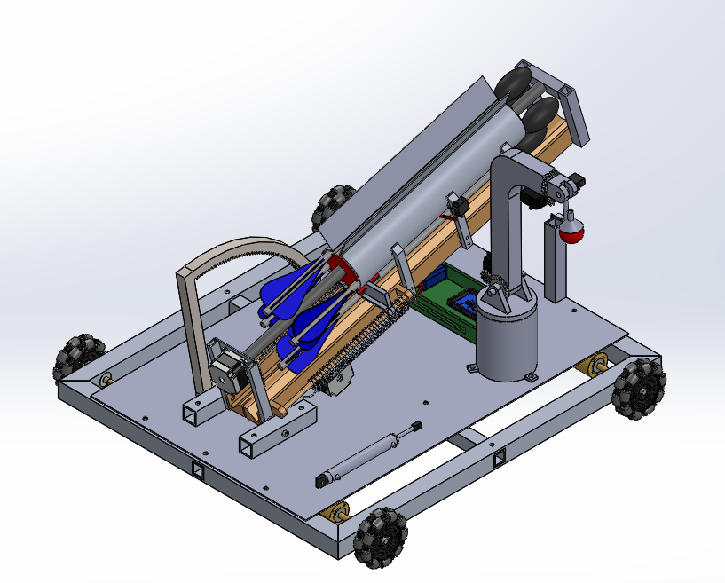

# Robocon 2021

SolidWorks design of our two robots for Robocon 2021, where the task was to throw arrows into pots.
The Defence Robot (DR) picks arrows up and passes them on. The Throw Robot (TR) stores arrows and
shoots them.

This repo only has the CAD. There is no code in it.

## Defence Robot (DR)

- Aluminium box section frame with a 2 mm sheet on top. 4 omni wheels, each driven by a 256 rpm
  planetary motor.
- A robotic arm with 4 degrees of freedom. Its last link is a universal gripper that is worked
  pneumatically by a 100 ml syringe.
- The arm picks arrows up from the ground. It can place an arrow in the shooting channel or drop it
  in the outer area for TR to pick up.
- The red claw sits on a vertical rack and pinion so its height can be changed.
- Same spring shooting channel as TR (see below).
- Electronics box with an Arduino Mega, battery, HC-SR04 ultrasonic sensor and MG996R servos.

## Throw Robot (TR)

TR has the same base, arm and gripper as DR. It picks arrows up from the arrow stand and the ground.

The extra part on TR is the arrow revolver. It holds 5 arrows with one more on the shooting channel.

- The arm puts an arrow in the wider top end of the revolver. The arrow slides down into the
  revolving chamber.
- The red plates rotate while the outer shell stays still.
- When an arrow reaches the lowest position a servo operated flap opens and the arrow falls onto the
  shooting channel.
- A motor at the bottom of the shooting channel pulls the grey pushing part back and stretches the
  two springs. Letting go of it shoots the arrow.
- The angle of the channel is set by a NEMA17 stepper driving the big curved gear (a section of a
  250 tooth internal gear).

## Files

| Path | What it is |
|---|---|
| `cad/dr` | SolidWorks parts and `Defence Robot.SLDASM` |
| `cad/tr` | SolidWorks parts and `Throw Robot.SLDASM` |
| `step/` | Zipped STEP export of each full robot (about 33 MB each once unzipped) |
| `images/` | Renders |
| `docs/parts.md` | Parts list with counts for both robots |

## Opening the files

The .SLDPRT and .SLDASM files were saved in SolidWorks 2020 so they need SolidWorks 2020 or newer.
Toolbox parts (gears, bearings, screws and nuts) and a few downloaded models (pneumatic cylinder,
HC-SR04, omni wheels, one servo) are not in `cad/`. SolidWorks will ask for them when you open an
assembly.

Without SolidWorks, unzip the file in `step/` and open the .STEP in Fusion 360, FreeCAD or any other
CAD program. The STEP has the whole robot with every part in it.
